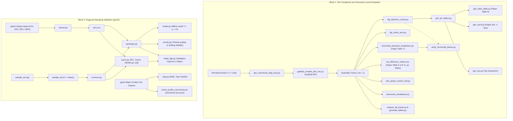

# Comprehensive Guide and Catalog of Project Scripts

This document provides a thorough and detailed description of every script and tool unified under `godbolt_kernels/tools/` (which brings together the Godbolt static/instruction-level analysis suite and the sampling validation framework originally in `analisis_revision/`). For each tool, we detail its operational purpose, internal mechanism (inputs, algorithms, and outputs), concrete role in the research, and direct correspondence with sections, tables, and figures in the scientific manuscript and response letters to reviewers.

---

## Table of Contents

1. [Block 1: Instruction-Level Analytical Evaluation & ISA Complexity (Godbolt, Assembly & CFG)](#block-1-instruction-level-analytical-evaluation--isa-complexity)
   - [`cfg_dynamic_counts.py`](#1-cfg_dynamic_countspy)
   - [`cfg_check_asm.py`](#2-cfg_check_asmpy)
   - [`gen_ph_tables.py`](#3-gen_ph_tablespy)
   - [`gen_latex_table.py`](#4-gen_latex_tablepy)
   - [`gen_sec4.py`](#5-gen_sec4py)
   - [`gen_tau.py`](#6-gen_taupy)
   - [`gen_vectorized_diag_loop.py`](#7-gen_vectorized_diag_looppy)
   - [`godbolt_compile_ph3_vec.py`](#8-godbolt_compile_ph3_vecpy)
   - [`horizontal_reduction_breakdown.py`](#9-horizontal_reduction_breakdownpy)
   - [`verify_horizontal_blocks.py`](#10-verify_horizontal_blockspy)
   - [`isa_efficiency_metrics.py`](#11-isa_efficiency_metricspy)
   - [`calc_phase_metrics_full.py`](#12-calc_phase_metrics_fullpy)
   - [`analyze_all_traces.py`](#13-analyze_all_tracespy)
   - [`generate_tables.py`](#14-generate_tablespy)
   - [`taxonomic_breakdown.py`](#15-taxonomic_breakdownpy)
   - [`check_profile_correctness.py`](#16-check_profile_correctnesspy)

2. [Block 2: Methodological Validation of Diagonal Sampling (gem5 Sampling Validation)](#block-2-methodological-validation-of-diagonal-sampling)
   - [`sample_sel.cpp` and `sample_sel`](#17-sample_selcpp-and-sample_sel)
   - [`common.py`](#18-commonpy)
   - [`extract.py`](#19-extractpy)
   - [`speedups.py`](#20-speedupspy)
   - [`model.py`](#21-modelpy)
   - [`trends.py`](#22-trendspy)
   - [`uarch.py`](#23-uarchpy)
   - [`mpq.py`](#24-mpqpy)
   - [`make_figs.py`](#25-make_figspy)

3. [Workflow and Dependency Diagram](#workflow-and-dependency-diagram)

---

## Block 1: Instruction-Level Analytical Evaluation & ISA Complexity

This toolset was designed to address the need for a microarchitecture-independent, fair comparison between Vector-Length Agnostic (VLA: ARM SVE and RISC-V RVV) ISAs and fixed-width packed SIMD architectures (x86-64 AVX2 and AVX-512) free from simulator microarchitectural assumptions and clock frequency biases. It conducts in-depth analyses of compiler-generated assembly (GCC 14.2 and Clang 18.1) across all four algorithmic phases of Matrix Profile computation:
- **PH1 (`init_window`)**: Window initialization and initial statistics calculation.
- **PH2 (`diag_step`)**: Elemental diagonal step calculation.
- **PH3 (`diag_loop`)**: Full diagonal loop iteration including vector length control and horizontal maximum/minimum search.
- **PH4 (`reduction`)**: Inter-thread reduction merging local profiles into global profiles.

---

### 1. `cfg_dynamic_counts.py`

- **Purpose:**  
  Serves as the primary analytical engine for control flow analysis. It constructs an instruction-level Control Flow Graph (CFG) directly from Godbolt compiler assembly traces for x86-64, AArch64 (ARM), and RISC-V.
- **Internal Mechanism:**  
  1. Parses assembly text, stripping compiler directives (`.cfi_*`, `.quad`, etc.) and partitioning code into basic blocks using conditional jumps, unconditional branches, and return instructions.
  2. Identifies back-edges via Depth-First Search (DFS) to locate natural loops and their headers.
  3. Uses dynamic programming on the CFG state space to calculate:
     - Exact static instruction count.
     - Exact dynamic instruction ranges (minimum and maximum).
     - Phase partitioning between outer loop setup overhead (*Setup*) and per-iteration steady-state cost (*Iter*).
- **Role in the Project and Manuscript:**  
  Underpins all numerical values in **Section 4** of the manuscript ("*Microarchitecture-independent instruction-level evaluation*") and directly populates Tables 6 and 7. It guarantees that reported instruction counts are exact mathematical bounds rather than empirical estimates.
- **Typical Usage:**  
  ```bash
  python3 godbolt_kernels/tools/cfg_dynamic_counts.py [--md] [--json output.json]
  ```

---

### 2. `cfg_check_asm.py`

- **Purpose:**  
  Lightweight CLI utility to inspect and verify any standalone assembly file (`.s`) locally.
- **Internal Mechanism:**  
  Imports the analysis core from `cfg_dynamic_counts.py` and runs it on the supplied assembly path, optionally allowing the user to specify a loop trip count.
- **Role in the Project and Manuscript:**  
  Used during algorithm development and tuning to assess how C++ modifications or compiler flag tweaks impacted assembly instruction counts before updating the master traces.
- **Typical Usage:**  
  ```bash
  python3 godbolt_kernels/tools/cfg_check_asm.py file.s [trip_count]
  ```

---

### 3. `gen_ph_tables.py`

- **Purpose:**  
  Automated generator of comparative instruction count tables in Markdown and text formats for all 4 algorithmic phases (PH1–PH4).
- **Internal Mechanism:**  
  Calls `cfg_dynamic_counts.run()`, parses SCAMP and SCRIMP traces under GCC 14.2 and Clang 18.1 across all variants (Scalar, AVX2, AVX-512, SVE, and RVV), and formats structured comparative matrices:
  $$\text{Static} \quad (\text{Dynamic Min} - \text{Dynamic Max}) \quad [\text{Setup} \mid \text{Iter}]$$
- **Role in the Project and Manuscript:**  
  Builds the foundational summary tables in the ISA complexity study (`godbolt_kernels/estudio_complejidad_isa_scamp_scrimp.md`) and validates compiler stability.
- **Typical Usage:**  
  ```bash
  python3 godbolt_kernels/tools/gen_ph_tables.py
  ```

---

### 4. `gen_latex_table.py`

- **Purpose:**  
  Generates the unified, publication-ready LaTeX table code inserted directly into the paper.
- **Internal Mechanism:**  
  Reads the dataset output from `cfg_dynamic_counts` and formats the rows adhering to the `elsarticle` journal template layout, organizing SCAMP vs. SCRIMP, GCC vs. Clang, and reporting static ($s$), dynamic ($d$), and per-iteration ($i$) instruction metrics.
- **Role in the Project and Manuscript:**  
  Directly outputs **Table 6 (`tab:comp_avx`)** in the manuscript: *"Static (s), dynamic (d), and per-iteration (i) instruction counts for SCAMP and SCRIMP across computational phases."*
- **Typical Usage:**  
  ```bash
  python3 godbolt_kernels/tools/gen_latex_table.py
  ```

---

### 5. `gen_sec4.py`

- **Purpose:**  
  Generates exact quantitative metrics and percentage deltas quoted in the narrative text of Section 4.
- **Internal Mechanism:**  
  Queries data from `gen_ph_tables.py` to calculate relative reduction percentages, loop unrolling expansion factors (Clang vs. GCC), and the exact fractional share that the horizontal search phase represents within the complete PH3 loop body.
- **Role in the Project and Manuscript:**  
  Ensures that all inline numbers cited in Section 4 (e.g., *"horizontal search consumes 50.7%--59.2% of the PH3 loop body in SCAMP..."*) are strictly synchronized with the underlying compiler traces.
- **Typical Usage:**  
  ```bash
  python3 godbolt_kernels/tools/gen_sec4.py
  ```

---

### 6. `gen_tau.py`

- **Purpose:**  
  Calculates the vector code expansion factor $\tau_{\text{exp}}$.
- **Internal Mechanism:**  
  Computes the metric:
  $$\tau_{\text{exp}} = \frac{I_{\text{vec}} - I_{\text{scalar}}}{I_{\text{scalar}}}$$
  evaluated over the midpoint of the dynamic instruction range for scalar vs. vector implementations to measure the code bloat introduced by vectorization management.
- **Role in the Project and Manuscript:**  
  Reported in the ISA complexity study to quantitatively isolate the vector setup overhead from computation loops.
- **Typical Usage:**  
  ```bash
  python3 godbolt_kernels/tools/gen_tau.py
  ```

---

### 7. `gen_vectorized_diag_loop.py`

- **Purpose:**  
  Generates synthetic, standalone C++ microbenchmarks for the PH3 loop of AVX2 and AVX-512 featuring vectorized horizontal reductions (`microbenchmarks/<alg>_<isa>_vectorized_loop.cpp`).
- **Internal Mechanism:**  
  Extracts the optimized reduction tree kernels from `*_vectorized.cpp` and wraps them directly into the diagonal loop structure used by the baseline implementations, replacing scalar reductions with shuffle-based vector trees.
- **Role in the Project and Manuscript:**  
  Essential for compiling and tracing the vectorized horizontal reduction variants on Godbolt, enabling an authentic, *apples-to-apples* comparison with RVV and SVE.
- **Typical Usage:**  
  ```bash
  python3 godbolt_kernels/tools/gen_vectorized_diag_loop.py
  ```

---

### 8. `godbolt_compile_ph3_vec.py`

- **Purpose:**  
  Automates remote compilation and trace retrieval through the public REST API of Compiler Explorer (Godbolt).
- **Internal Mechanism:**  
  Transmits the C++ sources created by `gen_vectorized_diag_loop.py` to Godbolt with exact compiler versions (GCC 14.2 and Clang 18.1) and optimization flags (`-O2 -mavx2` and `-O2 -mavx512f -mavx512dq`), automatically storing the resulting assembly traces in `godbolt_kernels/outputs/trazas microbenchmarks completos/`.
- **Role in the Project and Manuscript:**  
  Guarantees open-science reproducibility of all compiler traces from any development environment without requiring local cross-compilation toolchains.
- **Typical Usage:**  
  ```bash
  python3 godbolt_kernels/tools/godbolt_compile_ph3_vec.py
  ```

---

### 9. `horizontal_reduction_breakdown.py`

- **Purpose:**  
  Performs an instruction-by-instruction functional taxonomy of the horizontal maximum/minimum search phase.
- **Internal Mechanism:**  
  Audits line boundaries in each assembly trace and categorizes each instruction into distinct functional sub-stages:
  - *Fold*: Parallel tree reduction or native ISA reduction.
  - *Broadcast / Max-Min*: Vector or scalar comparison with the current profile value.
  - *Mask Gen / Extraction*: Predicate generation and bitmask isolation.
  - *Index Extraction*: Calculation of the relative match index.
  - *Cross-Domain*: Vector-to-general-purpose register bridging.
- **Role in the Project and Manuscript:**  
  Supplies all data for **Table 7 (`tab:horizontal_breakdown`)** in the paper, proving that SVE and RVV complete horizontal reductions in 5–7 links, whereas x86 AVX requires 14–17 links.
- **Typical Usage:**  
  ```bash
  python3 godbolt_kernels/tools/horizontal_reduction_breakdown.py
  ```

---

### 10. `verify_horizontal_blocks.py`

- **Purpose:**  
  Automated verification script ensuring formal consistency between manual taxonomy and graph algorithms.
- **Internal Mechanism:**  
  Cross-checks the line-by-line categorization of `horizontal_reduction_breakdown.py` against the CFG traversal of `cfg_dynamic_counts.py`, verifying that the sum of taxonomic components matches the exact CFG dynamic range across all 24 configurations.
- **Role in the Project and Manuscript:**  
  Eliminates human error in Table 7 data curation, guaranteeing 100% formal alignment.
- **Typical Usage:**  
  ```bash
  python3 godbolt_kernels/tools/verify_horizontal_blocks.py
  ```

---

### 11. `isa_efficiency_metrics.py`

- **Purpose:**  
  Calculates advanced processor-independent microarchitectural efficiency metrics:
  - Instruction-Level Parallelism: $\text{ILP} = I_{\text{d}} / D_{\text{cp}}$
  - Critical path depth ($D_{\text{cp}}$)
  - Serialization ratio: $D_{\text{cp}} / I_{\text{d}}$
  - CISC micro-operation decomposition ($\mu\text{Ops}$) for x86 fused instructions.
  - Total sequential pseudocycles required to compute $10\,000$ diagonals.
- **Internal Mechanism:**  
  Evaluates Read-After-Write (RAW) data dependency chains across iteration bodies, models unit-latency sequential execution bounds, and decouples memory-compute CISC instructions into independent load and execute $\mu\text{Ops}$.
- **Role in the Project and Manuscript:**  
  Directly populates **Table 8 (`tab:ILP_metrics`)** and equations (4) and (5) in the paper, explaining why RVV and SVE achieve more than double the effective instruction-level parallelism of AVX-512.
- **Typical Usage:**  
  ```bash
  python3 godbolt_kernels/tools/isa_efficiency_metrics.py
  ```

---

### 12. `calc_phase_metrics_full.py`

- **Purpose:**  
  Detailed analysis tool decomposing phase-level micro-operations and memory instruction ratios.
- **Internal Mechanism:**  
  Aggregates metrics across all four phases to quantify the micro-operation penalty imposed by x86 complex memory operands relative to the load-store RISC model of ARM and RISC-V.
- **Role in the Project and Manuscript:**  
  Provides the quantitative evidence in Section 4.1 demonstrating that AVX instruction counts increase by 16.7% to 25.6% when decomposed into micro-operations.
- **Typical Usage:**  
  ```bash
  python3 godbolt_kernels/tools/calc_phase_metrics_full.py
  ```

---

### 13. `analyze_all_traces.py`

- **Purpose:**  
  Batch parser analyzing branch instructions and static density across assembly traces.
- **Internal Mechanism:**  
  Scans compiler output files, identifying branch instructions, control flow structures, and conditional jump densities within `diag_step` (MB2).
- **Role in the Project and Manuscript:**  
  Used during initial research phases to characterize loop-unrolling heuristics in GCC vs. Clang.
- **Typical Usage:**  
  ```bash
  python3 godbolt_kernels/tools/analyze_all_traces.py
  ```

---

### 14. `generate_tables.py`

- **Purpose:**  
  Console summary table generator for fast inspection.
- **Internal Mechanism:**  
  Parses individual trace outputs and outputs formatted terminal tables summarizing total static instruction counts per function and compiler.
- **Role in the Project and Manuscript:**  
  Diagnostic and quick visual auditing tool for the development team.
- **Typical Usage:**  
  ```bash
  python3 godbolt_kernels/tools/generate_tables.py
  ```

---

### 15. `taxonomic_breakdown.py`

- **Purpose:**  
  General instruction classifier across x86, ARM, and RISC-V architectures.
- **Internal Mechanism:**  
  Categorizes assembly mnemonics into functional classes: Arithmetic, Memory Load/Store, Control Flow, Vector SIMD, Predicate/Mask manipulation, and System.
- **Role in the Project and Manuscript:**  
  Used to determine the execution overhead of predicate management instructions in ARM SVE relative to RVV mask operations.
- **Typical Usage:**  
  ```bash
  python3 godbolt_kernels/tools/taxonomic_breakdown.py
  ```

---

### 16. `check_profile_correctness.py`

- **Purpose:**  
  Numerical accuracy and scientific fidelity validation suite.
- **Internal Mechanism:**  
  Loads Matrix Profile CSV outputs generated by gem5 simulations across all algorithms, architectures, and vector lengths. Compares row-by-row:
  - Floating-point distance profile values ($MP[i]$) within a configurable precision tolerance (`--decimals`).
  - Nearest-neighbor index values ($MPI[i]$).
  - Flags any numerical divergences or index ties.
- **Role in the Project and Manuscript:**  
  Directly addresses reviewer requests ensuring that reported vector speedups correspond to 100% mathematically correct Matrix Profile calculations.
- **Typical Usage:**  
  ```bash
  python3 godbolt_kernels/tools/check_profile_correctness.py --decimals 4
  ```

---

## Block 2: Methodological Validation of Diagonal Sampling

This block was developed to address the critical inquiries from **Reviewer 2 (Comment 5)** and **Reviewer 3 (Comment 1)**. It provides rigorous mathematical and experimental proof that processing a 10% sampled subset of shuffled diagonals in gem5:
1. Faithfully preserves cache miss rates, CPI, and microarchitectural behavior compared to full 100% simulation.
2. Preserves performance scaling curves, optimum thread points, and ISA comparative rankings.
3. Yields conservative (lower-bound) speedup estimates for high thread counts due to fixed setup costs.

---

### 17. `sample_sel.cpp` and `sample_sel`

- **Purpose:**  
  High-performance C++ reference emulator replicating the diagonal selection algorithm of SCAMP/SCRIMP.
- **Internal Mechanism:**  
  Replicates the exact diagonal generation and pseudo-random shuffling algorithm:
  - Partitions a time series of length $P$ with window $w$ into meta-diagonals of step $V$.
  - Shuffles them using `std::mt19937` with identical fixed seed (42).
  - Selects the fraction requested (10%, 25%, 100%).
  - Computes the exact number of distance matrix cells computed by each selected meta-diagonal.
- **Role in the Project and Manuscript:**  
  Provides the ground truth for the exact amount of computation work (matrix cells) executed in each simulation.
- **Compilation and Usage:**  
  ```bash
  g++ -O3 godbolt_kernels/tools/sample_sel.cpp -o godbolt_kernels/tools/sample_sel
  ./godbolt_kernels/tools/sample_sel <P> <w> <V> <pct> <shuffle>
  ```

---

### 18. `common.py`

- **Purpose:**  
  Core shared library providing caching, parallel scheduling simulation, and statistical tools.
- **Internal Mechanism:**  
  - Caches `sample_sel` executions using LRU caches (`selection()`, `total_cells()`).
  - Simulates OpenMP dynamic scheduling (`#pragma omp parallel for schedule(dynamic)`) using a min-heap model (`dyn_makespan()`) to compute theoretical makespan, parallel speedup upper bound (`max_par`), and load-balancing efficiency (`bal_eff`).
  - Provides statistical utilities: geometric mean (`gmean`), Spearman rank correlation (`spearman`), and log-Pearson correlation (`pearson_log`).
  - Provides `load_runs()` to load and filter `runs.csv`.
- **Role in the Project and Manuscript:**  
  Shared mathematical foundation supporting all sampling validation scripts.

---

### 19. `extract.py`

- **Purpose:**  
  High-throughput multiprocessing parser extracting gem5 simulation statistics.
- **Internal Mechanism:**  
  Traverses hundreds of simulation directories in parallel (`multiprocessing.Pool`):
  - Parses the Region of Interest (ROI) statistics from `stats.txt`.
  - Extracts execution seconds (`simSeconds`), instructions (`simInsts`), operations (`simOps`), DRAM read/write volume, Instruction Queue (IQ) full stalls, Load/Store Queue (LSQ) full stalls, branch mispredictions, vector instruction counts, rename stalls, and L1/L2/L3 cache misses and accesses.
  - Consolidates all runs into `out/runs.csv` (over 2.6 MB of structured data).
- **Role in the Project and Manuscript:**  
  Bridges raw gem5 simulation artifacts into structured tables for statistical analysis.
- **Typical Usage:**  
  ```bash
  python3 godbolt_kernels/tools/extract.py
  ```

---

### 20. `speedups.py`

- **Purpose:**  
  Constructs master speedup tables (Metric A in the manuscript).
- **Internal Mechanism:**  
  Matches vectorized simulations with their corresponding single-threaded scalar baselines across algorithms, ISAs, datasets, and sampling fractions (10%, 25%, 100%):
  - Calculates raw speedup: $S = T_{\text{scalar}} / T_{\text{vector}}$.
  - Calculates coverage-corrected speedup:
    $$S_{\text{corr}} = S \times \frac{\text{coverage}_{\text{vector}}}{\text{coverage}_{\text{scalar}}}$$
  - Generates `out/speedups_shuf.csv` and `out/speedups_noshuf.csv`.
- **Role in the Project and Manuscript:**  
  Demonstrates in Section 5.1 that speedup deviations between 10% and 100% are strictly caused by minor differences in cell coverage and disappear once normalized.
- **Typical Usage:**  
  ```bash
  python3 godbolt_kernels/tools/speedups.py
  ```

---

### 21. `model.py`

- **Purpose:**  
  Fits and validates execution time extrapolation models.
- **Internal Mechanism:**  
  Calibrates an affine cost model:
  $$T = a + c \cdot X$$
  where $X$ represents either total cells covered ($M_1$) or dynamic makespan ($M_2$). Calibrates parameters $a$ and $c$ using 10% and 25% runs, predicts the 100% execution time, and compares the prediction against ground-truth 100% gem5 simulations. Generates `out/model_fit.csv`.
- **Role in the Project and Manuscript:**  
  Provides rigorous proof in the revision report that execution time scales linearly with the sampled diagonal fraction.
- **Typical Usage:**  
  ```bash
  python3 godbolt_kernels/tools/model.py
  ```

---

### 22. `trends.py`

- **Purpose:**  
  Evaluates scaling trend preservation, optimal thread allocation, and ISA ranking consistency.
- **Internal Mechanism:**  
  - Computes Metric B (speedup relative to scalar baseline with identical thread count).
  - Checks whether the optimal thread count ($\text{argmax}_{\text{threads}} S$) at 10% sampling matches that at 100%.
  - Verifies that pair-wise performance rankings between RVV and SVE are preserved.
- **Role in the Project and Manuscript:**  
  Validates the paper's claim that 10% sampling is completely reliable for architectural decision-making and cross-ISA comparisons.
- **Typical Usage:**  
  ```bash
  python3 godbolt_kernels/tools/trends.py
  ```

---

### 23. `uarch.py`

- **Purpose:**  
  Audits the stability of microarchitectural metrics across sampling fractions.
- **Internal Mechanism:**  
  Generates `out/uarch_shuf.csv` and computes relative ratios (`out/uarch_ratio.csv`) between 10% and 100% runs for:
  - Core IPC.
  - Instructions executed per computed matrix cell.
  - Vector instruction percentage.
  - L1, L2, and L3 cache miss rates.
  - DRAM bandwidth and bytes transferred per cell.
  - Pipeline stall rates (IQ full, LSQ full, FU busy).
- **Role in the Project and Manuscript:**  
  Provides empirical proof for Section 5.1 that per-cell cache miss rates and memory traffic vary by less than 2.7% between 10% and 100% runs, addressing Reviewer 2's concerns.
- **Typical Usage:**  
  ```bash
  python3 godbolt_kernels/tools/uarch.py
  ```

---

### 24. `mpq.py`

- **Purpose:**  
  Evaluates the algorithmic quality and motif fidelity of the approximate Matrix Profile produced by sampling.
- **Internal Mechanism:**  
  Loads distance profiles (`out/mp_quality.csv`) and calculates:
  - Mean Absolute Error (MAE), Root Mean Square Error (RMSE), and Maximum Error.
  - Overlap in top-$k$ motif discovery ($k=1, 5, 10$) and discords, enforcing an exclusion zone of $w/2$.
- **Role in the Project and Manuscript:**  
  Supplies algorithmic context confirming that a 10% diagonal sample preserves motif discovery accuracy for fast exploratory time-series mining.
- **Typical Usage:**  
  ```bash
  python3 godbolt_kernels/tools/mpq.py
  ```

---

### 25. `make_figs.py`

- **Purpose:**  
  Generates all publication-quality validation figures.
- **Internal Mechanism:**  
  Processes data tables and produces vectorized PDF and high-resolution PNG (200 dpi) plots in `out/figs/`:
  - **Fig 1 (`fig1_vlen_sweep_1thread`)**: VLEN sweep curves (1 thread) for 10%, 25%, and 100% fractions.
  - **Fig 2 (`fig2_thread_sweep_*`)**: Multi-threading scalability curves comparing all fractions.
  - **Fig 3 (`fig3_scatter_error_and_correlation`)**: Error distribution and correlation scatter plots.
  - **Fig 5 (`fig5_uarch_ratios_vs_100pct`)**: Stability of normalized microarchitectural metrics relative to 100%.
- **Role in the Project and Manuscript:**  
  Generates **Figure 5** in the manuscript (*"Validation of the 10% diagonal sampling methodology..."*) and figures in the response to reviewers.
- **Typical Usage:**  
  ```bash
  python3 godbolt_kernels/tools/make_figs.py
  ```

---

## Workflow and Dependency Diagram



---

## Manuscript and Response Letter Mapping Summary

| Script | Section in Paper / Letter | Generated Table / Figure | Key Functional Contribution |
|---|---|---|---|
| `cfg_dynamic_counts.py` | Sec. 4 | Core engine for Tables 6 & 7 | Exact static/dynamic instruction bounds via CFG |
| `gen_latex_table.py` | Sec. 4.1 | **Table 6** (`tab:comp_avx`) | LaTeX source for instruction counts across phases |
| `horizontal_reduction_breakdown.py` | Sec. 4.2 | **Table 7** (`tab:horizontal_breakdown`) | Fine-grained taxonomy of horizontal reductions |
| `isa_efficiency_metrics.py` | Sec. 4.2 | **Table 8** (`tab:ILP_metrics`), Eqs. 4 & 5 | Microarchitectural ILP, $D_{\text{cp}}$, and sequential steps |
| `gen_sec4.py` | Sec. 4 | Sec. 4 Narrative paragraphs | Exact numerical ratios quoted in manuscript text |
| `extract.py` | Sec. 5.1 & 5.2 | Database `runs.csv` | Multiprocessing parser of gem5 ROI metrics |
| `uarch.py` | Sec. 5.1 | Microarchitectural validation table | Proves < 2.7% variation in IPC, caches, and DRAM |
| `speedups.py` | Sec. 5.1 & Sec. 6 | Metric A Speedup curves | Speedups normalized by computed matrix cells |
| `trends.py` | Sec. 5.1 | Responses R2.C5 & R3.C1 | Demonstrates that 10% sampling predicts optimal threads and ISA rankings |
| `make_figs.py` | Sec. 5.1 | **Figure 5** in manuscript | Scalability curves and microarchitectural stability 10% vs 100% |
| `check_profile_correctness.py` | Sec. 5 & 6 | Response R2.C6 / Validation | Floating-point correctness and row-by-row accuracy verification |
